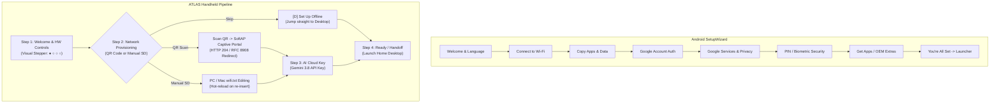

# Android Onboarding Architecture & Porting Guide for ATLAS OS

**Document Version:** 1.0.0  
**Target Platform:** ATLAS OS (ESP32-S3 Xtensa LX7 Dual-Core, 320x240 LCD, Joystick + 4 Buttons)  
**Primary Sources:**
- AOSP `packages/apps/Provision` (`DefaultActivity.java`, `DEVICE_PROVISIONED`, `USER_SETUP_COMPLETE`): [AOSP Source](https://android.googlesource.com/platform/packages/apps/Provision/)
- Google Android SetupWizard & Google TV Setup Specification: [Android Developers](https://source.android.com/devices/tech/connect/wifi-easy-connect)
- IETF RFC 8908 (*Captive Portal API*) & RFC 8910 (*DHCP Captive Portal Option*): [IETF Datatracker](https://datatracker.ietf.org/doc/html/rfc8908)
- ZXing Wi-Fi Network QR Code Specification: [ZXing GitHub](https://github.com/zxing/zxing/wiki/Barcode-Contents#wi-fi-network-config-android-ios-11)
- Chromium & Android Captive Portal Probing Specification: [Chromium Network Stack](https://chromium.googlesource.com/chromium/src/+/main/net/docs/captive-portal.md)

---

## 1. Executive Summary & Android Architectural Model

In the Android operating system family (AOSP, Google Mobile Services, Wear OS, Google TV, Android Auto), device onboarding is not treated as an ad-hoc screen. It is an explicit, staged system service governed by the **Provisioning State Machine** and **SetupWizard** pipeline.

For a resource-constrained, non-touch handheld device like ATLAS (ESP32-S3, 320x240 LCD, joystick + physical tactile buttons), Google TV and Wear OS offer the most relevant design models:
1. **Physical Remote / Controller Constraints:** Google TV cannot assume touch input. Typing long passwords with a D-pad is error-prone and frustrating.
2. **Dual-Path Provisioning:** Google TV provides two immediate paths:
   - **Path A (Phone / QR Code Fast Pair):** Point the phone camera at a QR code to transfer Wi-Fi credentials directly.
   - **Path B (On-Device Manual Fallback):** Configure network manually using physical controls or external storage.
3. **Graceful Degradation:** Users can always choose **"Set Up Offline"** to reach the launcher immediately without being blocked by lack of internet.

---

## 2. AOSP Provisioning Architecture & State Flags

In open-source Android (AOSP), onboarding lifecycle is regulated by two critical system properties in `Settings.Global` and `Settings.Secure`:

```java
// packages/apps/Provision/src/com/android/provision/DefaultActivity.java
Settings.Global.putInt(getContentResolver(), Settings.Global.DEVICE_PROVISIONED, 1);
Settings.Secure.putInt(getContentResolver(), Settings.Secure.USER_SETUP_COMPLETE, 1);
```

### Architectural Responsibilities:
| AOSP Concept | Purpose in Android | Ported Equivalent in ATLAS OS |
|---|---|---|
| `DEVICE_PROVISIONED` | Hardware initialized and core partitions mounted. | `atlas_boot.c` Stage 7 (`s_diag_snapshot.sdcard_ok`, partition validation). |
| `USER_SETUP_COMPLETE` | User completed setup wizard. Launcher is now the active shell. | `/sdcard/config/onboarding.json` (`onboarding_completed: true`) & NVS `onboard_ver`. |
| `Provision.apk` | Self-disabling setup gatekeeper before launching `Launcher.apk`. | `screen_onboarding.c` invoked by `atlas_boot.c` before `screen_home_run()`. |
| `POST_OTA_UPDATE` | Detects OS upgrade; displays "What's New" rather than re-provisioning. | `atlas_onboarding_state_t.is_update_reonboard` (`completed_version != running_version`). |

---

## 3. Android Captive Portal Detection Architecture

### The Probing Sequence
When an Android or iOS device connects to a Wi-Fi network, the background connectivity manager issues HTTP probes to verify internet reachability:
1. **Android:** Sends plain HTTP GET to `http://connectivitycheck.gstatic.com/generate_204` (or `clients3.google.com/generate_204`).
2. **iOS / macOS:** Sends GET to `http://captive.apple.com/hotspot-detect.html`.
3. **Windows:** Sends GET to `http://www.msftconnecttest.com/connecttest.txt`.
4. **Linux / Firefox:** Sends GET to `http://detectportal.firefox.com/success.txt`.

### Captive Interception Handshake
- If the network is unrestricted, Google's server returns **HTTP 204 No Content**.
- If the access point intercepts DNS queries (`*` -> `192.168.4.1`) and returns **HTTP 302 Found** with `Location: http://192.168.4.1/`, Android immediately displays the system notification:
  > **"Tap to sign in to ATLAS-SETUP"**
- Tapping opens the portal in **Android Custom Tabs** without requiring the user to open a browser or manually type an IP address.

### The RFC 8908 Modern Standard
RFC 8908 defines the modern standard for JSON-based captive portal signaling via DHCP Option 114, returning `{ "captive": true, "user-portal-url": "..." }`.

---

## 4. The ZXing Wi-Fi QR Code Standard

Under the open-source ZXing standard supported by Android, iOS 11+, and the Wi-Fi Alliance WPA3 specification:

```text
WIFI:T:nopass;S:<SSID>;;
```

When an open AP QR code with format `WIFI:T:nopass;S:ATLAS-SETUP-XXXX;;` is scanned by an Android or iOS camera:
1. The camera viewfinder immediately renders an interactive badge: **"Join 'ATLAS-SETUP-XXXX' Network"**.
2. The user taps the badge, and the mobile operating system handles association in the background.
3. The OS fires its `generate_204` probe, detects the 302 redirect, and launches the setup UI.

---

## 5. Android Setup Wizard Sequence vs. ATLAS Ported Pipeline



---

## 6. Porting Android Best Practices to ATLAS OS

### Feature 1: Android-Style Visual Stepper (Breadcrumb Progress)
- **Problem:** Users lose context on how long setup will take.
- **Port:** Render top-level progress dots (`● ○ ○ ○`) and step titles (`Step 1 of 4: Welcome`, `Step 2 of 4: Wi-Fi`, `Step 3 of 4: Gemini AI`, `Step 4 of 4: Ready`).

### Feature 2: Standard ZXing QR Wi-Fi String
- **Format:** `WIFI:T:nopass;S:ATLAS-SETUP-XXXX;;`
- **Port:** Generates instant "Tap to Join" camera overlay on all modern phones.

### Feature 3: Universal Captive Portal Redirection
- **Endpoints Registered on ESP32-S3 HTTP Server:**
  - `/generate_204` & `/gen_204` (Android / Chromium)
  - `/hotspot-detect.html` (iOS / macOS)
  - `/connecttest.txt` & `/ncsi.txt` (Windows)
  - `/success.txt` (Firefox / Linux)
  - Returns `302 Found` with `Location: http://192.168.4.1/`.

### Feature 4: "Set Up Offline" Bypass Option
- **Android Standard:** Never trap the user if network is unavailable.
- **Port:** Pressing `[D] Skip / Set Up Offline` allows immediate device access. Onboarding marks `is_completed: true` with `wifi_configured: false`.

### Feature 5: Post-OTA Non-Destructive "What's New" Experience
- **Android Standard:** OS updates display release notes while preserving existing network credentials and user data.
- **Port:** When `s_onboard_state.is_update_reonboard` is true, Atlas presents the update changelog, verifies existing Wi-Fi link in the background, and advances directly to the desktop with `[A] Continue`.

