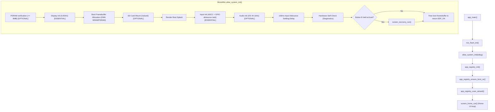

# ATLAS OS Baseline Audit & Reconnaissance Report

**Date:** 2026-10-30  
**Target Hardware:** ESP32-S3 (ESP32-S3-WROOM-1 / DevKitC-1-N8/N16R8 profile)  
**Toolchain:** PlatformIO 7.0.1, ESP-IDF v6.0.1 (GCC 15.2.0, Xtensa-ESP-ELF)  
**Firmware Version:** Atlas OS v1.0 / Architecture Milestone 1  

---

## 1. Executive Summary

This document establishes the architectural baseline of the **ATLAS** handheld terminal firmware prior to implementing the Linux-inspired operating system architecture. It details module responsibilities, initialization dependencies, hardware constraints, storage architecture, build status, identified architectural bottlenecks, and the migration strategy.

---

## 2. Current Architecture & Codebase Map

The current firmware is structured as a single ESP-IDF component under `main/`:

```text
Atlas/
├── CMakeLists.txt              # Top-level ESP-IDF project definition
├── platformio.ini              # PlatformIO environment (board: esp32-s3-devkitc-1, framework: espidf)
├── partitions.csv              # Custom 16MB flash partition table
├── sdkconfig.atlas             # PlatformIO sdkconfig cache
├── sdkconfig.defaults          # Core ESP-IDF sdkconfig overrides (FreeRTOS 1000Hz, Octal PSRAM 80MHz)
├── main/
│   ├── CMakeLists.txt          # Component registration & dependencies
│   ├── main.c                 # Entry point (`app_main`)
│   ├── include/
│   │   └── atlas_pins.h        # Hardware pin assignments & peripheral mappings
│   ├── drivers/
│   │   ├── atlas_display.c/.h  # ILI9341 SPI LCD driver with DMA ping-pong buffers
│   │   ├── atlas_input.c/.h    # ADC1 analog joystick & debounced tactile switches
│   │   ├── atlas_audio.c/.h    # MAX98357A I2S DAC (TX) & INMP441 I2S Mic (RX)
│   │   └── atlas_sdcard.c/.h   # SDSPI FatFS driver (shared SPI2 bus with display)
│   ├── system/
│   │   ├── atlas_init.c/.h     # Monolithic bootstrap sequence & hardware self-test
│   │   └── app_registry.c/.h   # NVS app registry, in-firmware dispatch, and OTA engine
│   └── ui/
│       ├── atlas_gfx.c/.h      # Framebuffer drawing primitives (lines, text, rects)
│       ├── screen_home.c/.h    # 2x2 grid home launcher UI loop
│       └── screen_recovery.c/.h# Recovery safe mode UI with confirmation prompts
└── scripts/
    └── convert_interceptor.py  # Utility asset script
```

---

## 3. Existing Module Responsibilities

| Module | Location | Primary Responsibilities | Existing State |
|---|---|---|---|
| **Entry Point** | `main.c` | Initializes NVS flash, calls system init, seeds registry, launches home UI. | Minimal (44 lines), but directly binds boot sequence to UI. |
| **System Init** | `atlas_init.c/.h` | Sequentially verifies PSRAM, inits display, mounts SD, renders splash, inits input & audio, runs diagnostics, checks recovery button. | Monolithic single function (`atlas_system_init`), hardcoded steps. |
| **App Registry** | `app_registry.c/.h` | Stores app metadata in NVS `atlas_apps`, scans `/sdcard/apps/`, dispatches compiled handlers, executes SD OTA firmware updates. | Mixed concerns: combines app registry, UI metadata, SD file scanning, and low-level OTA flashing in one file. |
| **Display Driver** | `atlas_display.c/.h` | ILI9341 320x240 RGB565 over SPI2_HOST. Implements async DMA transfer with double line buffers. | Functional, high performance, clean API. |
| **Input Driver** | `atlas_input.c/.h` | ADC1 oneshot for X/Y joystick; GPIO polling task for 4 debounced switches (SW1-SW4). | Thread-safe, background FreeRTOS task, calibrated coordinates. |
| **Audio Driver** | `atlas_audio.c/.h` | MAX98357A I2S TX (I2S_NUM_0) and INMP441 I2S RX (I2S_NUM_1). Volume acoustic clamping. | Fully operational driver. |
| **SD Driver** | `atlas_sdcard.c/.h` | MicroSD over SPI2_HOST via SDSPI and FatFS, mounted at `/sdcard`. | Stable SDSPI at 20 MHz with bus isolation. |
| **Home Screen** | `screen_home.c/.h` | 2x2 grid card launcher. Maps cards to stable `APP_ID_*` identifiers. Handles input polling and rendering. | Interactive, but cards are statically declared. |
| **Recovery Safe Mode** | `screen_recovery.c/.h` | Emergency recovery UI. Supports armed 2-step NVS factory erase, reboot, and boot continuation. | Operational and safe. |
| **Graphics Primitives** | `atlas_gfx.c/.h` | In-memory 16-bit RGB565 pixel manipulation (rectangles, text, centering, outlines). | Optimized CPU rendering. |

---

## 4. Initialization Dependencies & Boot Sequence

The existing boot sequence executes as follows:



### Dependency Analysis
1. **Critical vs Optional distinction:** Already recognized in `atlas_init.c`: Display and Input are classified as `ESSENTIAL`; PSRAM, SD card, Audio, and Mic RX are `OPTIONAL`.
2. **Coupling:**
   - Display driver must initialize before boot splash rendering.
   - Input task must be created and settled (80–100 ms) before evaluating the recovery trigger (Button B).
   - NVS must be initialized before `app_registry_init()`.
   - SD card mount must occur before `app_registry_scan_sdcard()`.

---

## 5. Storage & Filesystem Architecture

### 5.1 Flash Partition Layout (`partitions.csv`)
Total Flash Size: **16 MB (0x1000000)**

| Name | Type | SubType | Offset | Size | Purpose |
|---|---|---|---|---|---|
| `nvs` | `data` | `nvs` | `0x0009000` | `64 KB` (`0x10000`) | Non-volatile key-value storage (WiFi, calibration, app metadata) |
| `otadata` | `data` | `ota` | `0x0019000` | `8 KB` (`0x2000`) | ESP-IDF OTA boot slot selection data |
| `phy_init` | `data` | `phy` | `0x001B000` | `4 KB` (`0x1000`) | RF calibration data |
| `factory` | `app` | `factory`| `0x0020000` | `2.5 MB` (`0x280000`) | Golden factory recovery firmware image |
| `ota_0` | `app` | `ota_0` | `0x02A0000` | `4.0 MB` (`0x400000`) | Primary Atlas OS runtime slot |
| `ota_1` | `app` | `ota_1` | `0x06A0000` | `4.0 MB` (`0x400000`) | Inactive OTA upgrade staging slot |
| `storage` | `data` | `spiffs` | `0x0AA0000` | `5.375 MB` (`0x560000`)| On-board SPIFFS storage (currently unmounted) |

### 5.2 MicroSD Card Interface
- **Physical Mount:** FAT32 MBR partition, verified capacity 30.98 GB (32 GB card).
- **Controller & Bus:** SDSPI driver sharing `SPI2_HOST` (FSPI) with the ILI9341 display.
  - LCD CS: `GPIO 5`
  - SD CS: `GPIO 10` (active LOW, hardware pull-up enabled)
  - SCK: `GPIO 12`, MOSI: `GPIO 11`, MISO: `GPIO 13`
- **Mount Point:** ESP-IDF VFS mount at `/sdcard`.
- **SPIFFS Status:** Partition defined in `partitions.csv` (5.375 MB), but no initialization code currently mounts it.

---

## 6. Hardware Constraints & Pin Assignments

All hardware pin assignments are fixed on the physical PCB and must be strictly preserved:

| Subsystem | Signal / Name | GPIO | Hardware Notes |
|---|---|---|---|
| **ILI9341 Display** | MOSI | GPIO 11 | Shared SPI2 bus |
| | SCK | GPIO 12 | Shared SPI2 bus |
| | MISO | GPIO 13 | Shared SPI2 bus |
| | CS | GPIO 5 | Active LOW |
| | DC | GPIO 7 | Data / Command select |
| | RST | GPIO 6 | Hardware reset |
| | BCKL | None (-1) | Tied to 5V rail on hardware |
| **MicroSD Card** | CS | GPIO 10 | Active LOW, SPI2 bus |
| **Joystick (ADC1)** | X-Axis | GPIO 4 | ADC1 Channel 3 |
| | Y-Axis | GPIO 1 | ADC1 Channel 0 |
| | Click | None (-1) | Not wired to switch |
| **Tactile Buttons** | SW1 (Btn A) | GPIO 42 | Active LOW, internal pull-up |
| | SW2 (Btn B) | GPIO 41 | Active LOW (Recovery Trigger) |
| | SW3 (Btn C) | GPIO 40 | Active LOW (Menu alias) |
| | SW4 (Btn D) | GPIO 39 | Active LOW |
| **Speaker (MAX98357A)**| DIN | GPIO 21 | I2S_NUM_0 TX Data |
| | BCLK | GPIO 17 | I2S_NUM_0 Bit Clock |
| | WS (LRCLK) | GPIO 18 | I2S_NUM_0 Word Select |
| | SD_MODE | GPIO 47 | Amp Enable (HIGH=active, LOW=mute) |
| **Mic (INMP441)** | SD | GPIO 16 | I2S_NUM_1 RX Data |
| | SCK | GPIO 14 | I2S_NUM_1 Serial Clock |
| | WS (LRCLK) | GPIO 15 | I2S_NUM_1 Word Select |

---

## 7. Current Build Status

The baseline build was executed with the real PlatformIO environment:
- **Command:** `pio run`
- **Result:** **SUCCESS** (Took 5.15s)
- **RAM Usage:** 13,680 bytes / 327,680 bytes (4.2%)
- **Flash Usage:** 367,342 bytes / 2,621,440 bytes (14.0%)
- **Warnings / Compiler Errors:** Clean, zero compilation errors.

---

## 8. Architectural Problems Identified

1. **Monolithic Boot Sequence:**
   `atlas_system_init()` executes all boot logic in a single 192-line function without distinct lifecycle phases (early hardware, storage, peripheral, service, UI). Adding new drivers or services requires directly editing this function.
2. **Lack of Inter-Service Event Bus:**
   Components currently communicate via direct function calls or global polls. When the SD card is mounted/unmounted or input events occur, there is no event notification mechanism for other services.
3. **Scattered Logging Conventions:**
   Components use raw `ESP_LOG*` macros directly with ad-hoc component tags. There is no unified ATLAS logging abstraction to manage system-wide log levels or routing.
4. **No Service Registry or Lifecycle Management:**
   Services (Input task, App Registry, Audio) are initialized ad-hoc. There is no registry to inspect service states (uninitialized, running, failed, stopped).
5. **No Structured System Information API:**
   Memory, PSRAM, uptime, and storage status are calculated separately in different files (`atlas_init.c`, `screen_home.c`, `screen_recovery.c`).
6. **Mixed Concerns in Application Registry:**
   `app_registry.c` manages NVS storage, SD card directory traversal, in-firmware app dispatching, and low-level OTA firmware flashing.
7. **Ponytail Audit Findings:**
   - Hand-rolled structs with reserved unused fields (`flash_offset`, `size`, `is_staged` in `app_registry.h`).
   - Redundant framebuffer allocations duplicated in `atlas_init.c`, `screen_home.c`, and `screen_recovery.c`.

---

## 9. Recommended Migration Plan

1. **Decompose Boot into Structured Boot Manager:**
   Create `boot/atlas_boot.h` and `boot/atlas_boot.c` to orchestrate discrete boot stages: Early Hardware -> Storage -> Peripherals -> Diagnostics -> Recovery Check -> Services -> Shell Launch.
2. **Implement Native Event System:**
   Leverage ESP-IDF's lightweight, battle-tested `esp_event` default loop (`core/atlas_event.h/.c`) with typed event bases (`ATLAS_SYSTEM_EVENTS`, `ATLAS_STORAGE_EVENTS`, `ATLAS_INPUT_EVENTS`).
3. **Centralize Component Logging:**
   Provide `core/atlas_log.h` wrapping `esp_log.h` with standard ATLAS log levels, uniform formatting, and component tagging.
4. **Lightweight Service Registry:**
   Implement `core/atlas_service.h/.c` to register core services, enforce dependency order, track runtime status, and expose state.
5. **Read-Only System Information API:**
   Create `core/atlas_sysinfo.h/.c` querying hardware, heap, PSRAM, storage, and uptime truthful metrics.
6. **Storage VFS Architecture:**
   Formalize `/sdcard` and internal `/spiffs` mappings into a coherent VFS design (`docs/STORAGE_DESIGN.md`).
7. **Future Application & Runtime Design:**
   Document the package format (APKG), application manager, dynamic launcher, and runtime comparison in `docs/ARCHITECTURE.md`.

