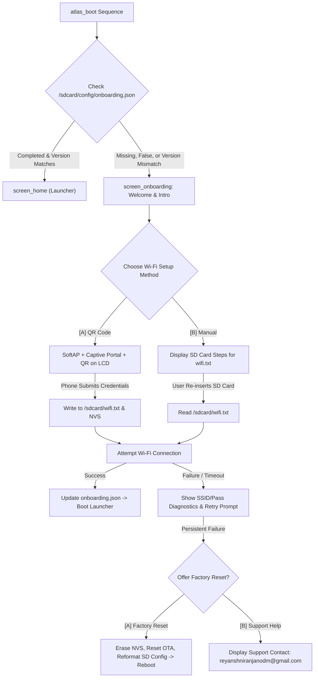

# ATLAS OS — Onboarding Lifecycle & Wi-Fi Provisioning Architecture

**Document:** `docs/ONBOARDING_AND_WIFI_RESEARCH.md`  
**Status:** Approved Research & Architectural Specification  
**Target Platform:** ESP32-S3 (Xtensa Dual-Core 240MHz, 8MB Octal PSRAM, ILI9341 320x240 LCD, SDSPI FatFS)  
**Framework:** ESP-IDF v6.0.1, FreeRTOS (1000Hz), PlatformIO  
**Support Contact:** `reyanshniranjanodm@gmail.com`  

---

## 1. Executive Summary

This document specifies the end-to-end design for the **ATLAS OS Onboarding & Wi-Fi Provisioning Subsystem**. It defines how a newly assembled or updated Atlas handheld introduces itself to the user, guides the user through connecting to local Wi-Fi, records onboarding state on external media (`/sdcard/config/onboarding.json`), detects OS firmware updates to trigger "What's New" re-onboarding, and provides bulletproof fallback diagnostics and factory reset recovery.



---

## 2. Onboarding State Tracking & Version Invalidation

### 2.1 File Location & Schema
Onboarding status is tracked primarily on the MicroSD card under the protected system configuration directory:  
**Primary Path:** `/sdcard/config/onboarding.json`  
**NVS Fallback Namespace:** `"atlas_cfg"` (key: `"onboard_ver"`)

#### JSON Schema (`/sdcard/config/onboarding.json`)
```json
{
  "version": 1,
  "onboarding_completed": true,
  "completed_os_version": "v1.0.0",
  "completed_build_date": "2026-11-04T22:45:00Z",
  "wifi_configured": true,
  "last_onboarding_timestamp": 1730764800
}
```

### 2.2 OTA Update Invalidation Logic
When an OS / firmware update is applied via `atlas_ota`:
1. On every boot, `atlas_boot` reads `esp_app_get_description()->version` (e.g. `v1.1.0`).
2. The boot sequence inspects `/sdcard/config/onboarding.json`.
3. If `onboarding.json` does not exist, `onboarding_completed == false`, OR `completed_os_version != current_firmware_version`:
   - The OS invalidates the onboarding state (`onboarding_completed = false`).
   - The OS triggers `screen_onboarding_run()`.
   - For a version mismatch (firmware upgrade), the onboarding flow displays the **"What's New in Atlas OS"** changelog screen before verifying Wi-Fi connectivity.

---

## 3. Screen-by-Screen User Experience Flow

```
┌────────────────────────────────────────────────────────┐
│ Screen 1: Welcome & Intro                              │
│ - Retro Cyberpunk Boot Animation                       │
│ - Welcome to ATLAS Handheld Terminal                   │
│ - Physical Controls Guide (Joystick + Buttons A,B,C,D) │
│ - Press [A] to Begin Setup                             │
└──────────────────────────┬─────────────────────────────┘
                           │
┌──────────────────────────▼─────────────────────────────┐
│ Screen 2: Wi-Fi Provisioning Selection                 │
│ "CONNECT TO WI-FI NETWORK"                             │
│                                                        │
│ [A] Fast QR Code Setup (Recommended)                   │
│     Scan with smartphone to configure instantly        │
│                                                        │
│ [B] Manual SD Card Setup                               │
│     Edit wifi.txt on your computer                     │
└────────────┬─────────────────────────────┬─────────────┘
             │                             │
             │ [A] QR Code                 │ [B] Manual
┌────────────▼────────────────┐ ┌──────────▼─────────────┐
│ Screen 3A: QR Code Portal   │ │ Screen 3B: Manual Guide│
│ - SoftAP: ATLAS-SETUP-XXXX  │ │ 1. Eject MicroSD card  │
│ - LCD renders 128x128 QR    │ │ 2. Plug into computer  │
│ - Phone scans -> Connects   │ │ 3. Open 'wifi.txt'     │
│ - Mobile Web UI selects AP  │ │ 4. Enter SSID & PASS   │
│ - Credentials received!     │ │ 5. Re-insert card      │
│ [A] Finished  [B] Cancel    │ │ [A] Done, Re-inserted  │
└────────────┬────────────────┘ └──────────┬─────────────┘
             │                             │
┌────────────▼─────────────────────────────▼─────────────┐
│ Screen 4: Wi-Fi Connection Testing                     │
│ "CONNECTING TO WI-FI NETWORK..."                       │
│ Connecting to: [ Home_Network_5G ]                     │
│ [████████████████░░░░░░░░] Attempt 1/3                 │
└────────────┬─────────────────────────────┬─────────────┘
             │                             │
             │ SUCCESS                     │ FAILURE
┌────────────▼────────────────┐ ┌──────────▼─────────────┐
│ Screen 5A: Connection OK    │ │ Screen 5B: Diagnostics │
│ - Status: CONNECTED         │ │ - ERROR: Failed to join│
│ - IP: 192.168.1.142         │ │ - Parsed SSID: MyWiFi  │
│ - Signal: -58 dBm           │ │ - Parsed Pass: ********│
│ - Acoustic Confirmation Chime│ │ - Reason: Bad Password │
│ [A] Enter ATLAS Desktop     │ │ [A] Retry  [B] Edit    │
└─────────────────────────────┘ └──────────┬─────────────┘
                                           │
                                           │ PERSISTENT FAILURE
                                ┌──────────▼─────────────┐
                                │ Screen 6: Recovery     │
                                │ "SETUP TROUBLESHOOTING"│
                                │ Issue persists?        │
                                │ [A] Perform Factory    │
                                │     Reset (Flash & SD) │
                                │ [B] Boot Offline Mode  │
                                │                        │
                                │ Need Help? Email us:   │
                                │ reyanshniranjanodm@    │
                                │ gmail.com              │
                                └────────────────────────┘
```

---

## 4. Technical Architecture & Component Selection

### 4.1 Embedded QR Code Generation on 320x240 LCD
- **Library Selection:** **Project Nayuki `qrcodegen` (C)**
  - Single C file (`qrcodegen.c`) and single header (`qrcodegen.h`).
  - Zero dynamic heap allocation (`malloc`); works entirely within a fixed stack buffer (`uint8_t qrcode[qrcodegen_BUFFER_LEN_MAX]`).
  - Generates standard QR Model 2 (Versions 1 through 10).
- **Display Dimensions & Rendering:**
  - Standard Wi-Fi pairing string: `WIFI:S:ATLAS-SETUP;T:nopass;;` (~30 characters).
  - Version 3 QR Code: $29 \times 29$ modules.
  - Pixel Scaling on 320x240 LCD: $4 \times 4$ pixels per module.
  - Active QR Dimensions: $29 \times 4 = 116 \times 116$ pixels.
  - Centered at $X = (320 - 116)/2 = 102$, $Y = 50$, leaving 50px for header and 74px for footer instructions.

### 4.2 SoftAP & Captive Portal Web Engine
When the user selects **QR Setup**:
1. Atlas initializes Wi-Fi in `WIFI_MODE_AP`:
   - SSID: `ATLAS-SETUP-XXXX` (using last 2 bytes of base MAC address).
   - Channel: 1.
   - Authentication: Open (`WIFI_AUTH_OPEN`) so smartphones connect with zero friction upon scanning the QR code.
   - IP Address: `192.168.4.1` (netmask `255.255.255.0`).
2. **DNS Captive Redirector:**
   - Lightweight UDP server on port 53.
   - Answers every DNS request with IP `192.168.4.1`, triggering the OS captive portal pop-up on iOS and Android.
3. **HTTP Server (`esp_http_server`):**
   - Serves an embedded retro-styled mobile web page from flash memory:
     - Scans nearby access points (`esp_wifi_scan_start()`).
     - Renders a dropdown list of available SSIDs with RSSI signal bars.
     - Form input for Wi-Fi Password.
     - Submit button sends `POST /api/connect`.
4. **Credential Dispatch:**
   - On receiving `POST /api/connect`, Atlas:
     - Writes `SSID` and `PASSWORD` to `/sdcard/wifi.txt`.
     - Commits credentials to NVS (`"atlas_wifi"` namespace).
     - Sends HTTP 200 with confirmation message.
     - Shuts down SoftAP and switches to Station mode (`WIFI_MODE_STA`).

### 4.3 Manual SD Card Workflow (`wifi.txt`)
If the user selects **Manual Setup** or the card is plugged into a PC:
- **File Path:** `/sdcard/wifi.txt`
- **File Format:**
  ```ini
  # =========================================================
  # ATLAS HANDHELD TERMINAL - WI-FI CONFIGURATION
  # =========================================================
  # Enter your Wi-Fi credentials below, save the file,
  # and re-insert the MicroSD card into your Atlas device.

  SSID=MyHomeNetwork
  PASSWORD=MySecretPassword123
  ```
- **Robust Parser Logic:**
  - Strips leading/trailing whitespace and Carriage Return (`\r\n`).
  - Ignores comments (`#` and `;`).
  - Handles surrounding quotes (`SSID="My Network"` -> `My Network`).
  - Enforces bounds: SSID 1–32 characters, Password 0–64 characters.

### 4.4 Connection Testing & Error Diagnostics
When attempting to connect:
- Atlas initializes station mode and sets a 15-second timeout.
- **ESP-IDF Event Disconnect Reasons:**
  - `WIFI_REASON_NO_AP_FOUND`: *"Network SSID not found in range. Check spelling."*
  - `WIFI_REASON_AUTH_EXPIRE` / `WIFI_REASON_4WAY_HANDSHAKE_TIMEOUT`: *"Authentication failed. Verify Wi-Fi password."*
  - `WIFI_REASON_BEACON_TIMEOUT`: *"Signal too weak. Move closer to router."*
- Diagnostic Screen renders:
  - Configured SSID: `Home_5G`
  - Configured Password: `••••••••••••` (press `[D]` to toggle show/hide)
  - Clear diagnosis text explaining the failure.
  - `[A]` Retry Connection, `[B]` Return to Method Selection.

### 4.5 Factory Reset Engine
If persistent issues occur and the user confirms a Factory Reset:
1. **NVS Flash Erase:**
   ```c
   nvs_flash_erase();
   nvs_flash_init();
   ```
2. **OTA Boot Partition Reset:**
   - Detects if running from an OTA slot (`ota_0` / `ota_1`).
   - If a golden factory image exists, sets boot target to `factory`.
   - Confirms running slot validity via `esp_ota_mark_app_valid_cancel_rollback()`.
3. **SD Card Sanitization:**
   - Unlinks `/sdcard/config/onboarding.json` and `/sdcard/wifi.txt`.
   - Preserves user files in `/sdcard/data/` while restoring pristine system template configurations.
4. **Acoustic & Visual Feedback:**
   - Plays a descending reset tone sequence (1000 Hz -> 500 Hz -> 250 Hz).
   - Displays support card:
     ```text
     DEVICE RESTORED TO FACTORY STATE.
     Restarting in 3 seconds...

     Support: reyanshniranjanodm@gmail.com
     ```
5. **System Restart:** Invokes `esp_restart()`.

---

## 5. Module Seams & Interface Signatures

### 5.1 Onboarding Controller (`main/system/atlas_onboarding.h`)
```c
#pragma once
#include "esp_err.h"
#include <stdbool.h>

typedef struct {
    bool is_completed;
    char completed_version[32];
    bool wifi_configured;
} atlas_onboarding_status_t;

/**
 * @brief Check whether onboarding is required for the current firmware release.
 * Compares /sdcard/config/onboarding.json with running esp_app_get_description().
 */
bool atlas_onboarding_is_required(void);

/**
 * @brief Mark onboarding as complete and commit state to SD card and NVS.
 */
esp_err_t atlas_onboarding_mark_complete(void);

/**
 * @brief Invalidate onboarding state (e.g. following OTA upgrade).
 */
esp_err_t atlas_onboarding_invalidate(void);

/**
 * @brief Parse /sdcard/wifi.txt and extract credentials.
 */
esp_err_t atlas_onboarding_parse_wifi_file(char *out_ssid, size_t ssid_len, 
                                          char *out_pass, size_t pass_len);

/**
 * @brief Execute a complete hardware, flash, and SD card factory reset.
 */
void atlas_onboarding_perform_factory_reset(void);
```

### 5.2 Captive Portal & SoftAP Engine (`main/core/atlas_captive.h`)
```c
#pragma once
#include "esp_err.h"
#include <stdbool.h>

typedef void (*atlas_captive_cred_cb_t)(const char *ssid, const char *password);

/**
 * @brief Start SoftAP, Captive DNS server, and Web Configuration Portal.
 * @param cred_cb Callback invoked when smartphone submits credentials.
 */
esp_err_t atlas_captive_start(atlas_captive_cred_cb_t cred_cb);

/**
 * @brief Stop SoftAP, DNS, and HTTP server.
 */
esp_err_t atlas_captive_stop(void);
```

### 5.3 Onboarding UI Screen (`main/ui/screen_onboarding.h`)
```c
#pragma once

/**
 * @brief Run the interactive onboarding wizard.
 * Blocks until setup completes, user skips to offline mode, or factory reset reboots.
 */
void screen_onboarding_run(void);
```

---

## 6. Implementation Feasibility & Resource Budget

- **Flash Footprint:**
  - `qrcodegen` C library: ~18 KB.
  - `esp_http_server` + minimal captive portal HTML: ~35 KB.
  - Total Flash delta: ~53 KB (easily fits within 16MB SPI Flash; currently 17.6% used).
- **RAM / Heap Footprint:**
  - QR generation stack buffer: 2 KB.
  - SoftAP netif & HTTP server task: ~8 KB internal SRAM, remainder in 8MB Octal PSRAM.
  - MicroSD FatFS read/write: 512 bytes sector buffer.
- **Safety Guarantees:**
  - Never traps or halts without human-readable screen diagnostics.
  - Always provides an offline bypass if the user has no Wi-Fi.
  - Provides instant support email (`reyanshniranjanodm@gmail.com`) on persistent failure.
